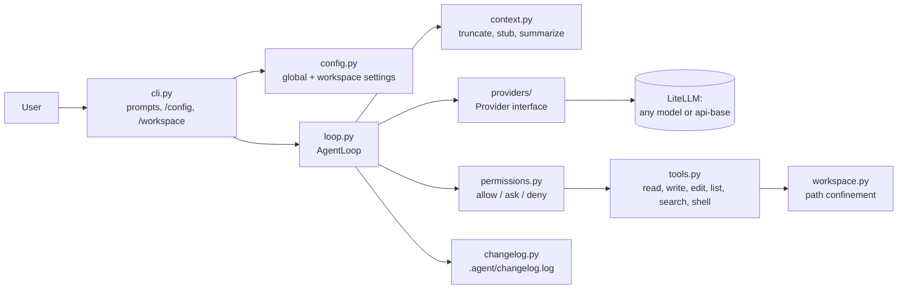

# Build Your Own AI Coding Agent

A personal AI coding agent for the terminal, written in Python. It runs the basic agentic loop (model call, tool call, observe, repeat) and adds the pieces that make it usable on real projects: a mandatory workspace directory, per-operation permissions, per-task context management and a compact change log. It works with any model that LiteLLM supports, using your own API key, and with OpenAI-compatible endpoints through `--api-base`.

The design is inspired by Claude Code, GitHub Copilot and Cursor Agent, and follows a Kiro-style task flow: understand, inspect, plan, execute, verify, report.

**Video:** _add your explainer video link here_

## Features

- **Bring your own key, any model.** LiteLLM is the first backend, behind a small `Provider` interface. Local and OpenAI-compatible servers work through `--api-base`.
- **Mandatory workspace.** You choose a directory before any task runs. File tools cannot leave it, including through symlinks.
- **Six tools.** `read_file`, `write_file`, `edit_file` (exact, unique search and replace), `list_dir`, `search` (regex) and `run_shell`.
- **Permissions.** Each category (`read`, `write`, `edit`, `shell`) is `allow`, `ask` or `deny`, set globally or for one directory, from an in-CLI `/config` menu.
- **Per-task context management.** Each task starts with a fresh history plus a short project summary. Large tool outputs are truncated, old bulky results are replaced by stubs, and the history is summarized when it nears the token budget.
- **Token-efficient change log.** The runtime writes one line per successful write or edit (path and a one-sentence reason) to `<workspace>/.agent/changelog.log`, with no extra model call, and prints a summary of at most 15 lines after each task.
- **Offline tests.** A scripted `FakeProvider` lets the whole loop be tested without network access.

## Architecture



One task runs as follows. The loop sends the history and tool schemas to the provider. For each tool call in the reply, it validates the arguments, asks the permission gate, runs the tool inside the workspace and appends the result to the history. When the model replies without tool calls, or the step limit is reached, the task ends and the change summary is printed. `agent/` depends on the `Provider` interface only; `litellm_provider.py` is the single module that imports LiteLLM.

See `docs/design-decisions.md` for the alternatives considered and why each choice was made, and `docs/security.md` for the limits of the safeguards.

## Install

Requires Python 3.10 or newer.

```
python -m venv .venv
.venv/bin/python -m pip install -e ".[dev]"
```

`.[dev]` adds pytest. Use `.` if you only want to run the agent.

## Quick start

```
export AGENT_API_KEY=...            # or a provider variable such as OPENAI_API_KEY
.venv/bin/python -m agent --model gpt-4o
```

The CLI asks for a workspace directory (required; the last one is offered again). Then type a task:

```
Workspace directory (required): ~/projects/demo
> create a small Python package with an add function and a test
```

Each line you type is one task. The agent prints its steps as it works. Tool calls show as `-> edit_file src/app.py` followed by a one-line result. When a category is set to `ask`, you are prompted `[y/n/a]` (yes, no, always for this session).

## Usage

Flags apply to the current run only:

| Flag | Meaning |
|---|---|
| `--workspace PATH` | Workspace directory (otherwise you are asked) |
| `--model NAME` | Model name, for example `gpt-4o` |
| `--max-steps N` | Maximum model calls per task (default 25) |
| `--api-base URL` | Custom API base URL, for local or OpenAI-compatible servers |

Commands inside the CLI: `/config` (permissions, model, API key), `/workspace` (switch directory), `/help`, `/exit`. Ctrl-C during a task interrupts it and returns to the prompt.

`run_shell` uses the workspace as its working directory, has a 60 s timeout and does not pass environment variables whose names look secret. Output is not token-streamed.

### Using any model

LiteLLM picks the provider from the model name, so any model it supports works with your own key:

```
export AGENT_API_KEY=...
.venv/bin/python -m agent --model gpt-4o
.venv/bin/python -m agent --model anthropic/claude-sonnet-4-5
```

For an OpenAI-compatible endpoint, such as a local model server or any gateway that speaks the OpenAI chat API, set `--api-base` and prefix the model name with `openai/` so LiteLLM uses the OpenAI protocol:

```
export AGENT_API_KEY=<key the endpoint expects>
.venv/bin/python -m agent --api-base http://localhost:8000/v1 --model openai/<model-id>
```

The endpoint's `/v1/models` route normally lists valid model IDs. When `--api-base` is set, the missing-credentials check is skipped, since some local servers need no key. The model and `api_base` can also be saved from `/config` or `config.json` (global only).

## Configuration and permissions

Type `/config` to view and edit each operation category as `allow`, `ask` or `deny`, and to choose where the change is saved: globally, or for the current workspace only.

| Scope | File | Notes |
|---|---|---|
| Global | `~/.config/agent-cli/config.json` (or `$XDG_CONFIG_HOME`, `%APPDATA%`, `$AGENT_CONFIG_DIR`) | Default everywhere |
| Workspace | `<workspace>/.agent/config.json` | Overrides global for that directory only |

Workspace settings win over global, per key. Defaults: `read` allow, `write`, `edit` and `shell` ask. The menu shows where each value comes from (`default`, `global`, `workspace`). Answering `always` at a prompt allows that category for the rest of the session only.

Other settings (`max_steps`, `shell_timeout_s`, `output_limit_chars`, `context_budget_tokens`) can be set in `config.json`. `model` and `api_base` are global only, so a cloned repository cannot redirect your API key. If a workspace config loosens a permission compared with your global mode, the CLI asks once per session before honoring it.

The API key comes from `AGENT_API_KEY`, else `credentials.json` in the global directory (mode 0600), else a provider variable such as `OPENAI_API_KEY`. A corrupt config file is ignored with a warning and never overwritten.

## Change log

Each task appends to `<workspace>/.agent/changelog.log`. The runtime writes it, and it is not sent to the model unless the model reads it.

```
# task 2026-01-15T10:32:00 | Add a CLI entry point
2026-01-15T10:32:05 | write | src/app.py | Create entry point with main()
2026-01-15T10:33:10 | edit | src/app.py | Fix off-by-one in loop
#> Task done: 2 change(s)
#>   src/app.py: Fix off-by-one in loop
#> verify: 1 shell run(s), last exit 0
# end 2026-01-15T10:32:00 done | 2 changes
```

Only successful writes and edits get a line. Reads and shell commands are never logged, and shell command text never reaches the file. The terminal summary also lists the shell commands that ran and their exit codes. The next task starts with fresh context plus a short project summary built from this log.

## Project layout

```
agent/
  cli.py            CLI: workspace prompt, /config menu, task prompt loop
  loop.py           AgentLoop: model call, tool calls, results, repeat
  tools.py          Tool schemas and implementations
  permissions.py    PermissionGate: allow / ask / deny per category
  config.py         Global and workspace settings, credentials, remembered state
  context.py        Truncation, stubbing and summarization of history
  changelog.py      Compact runtime-written change log
  workspace.py      Workspace selection and path confinement
  prompts.py        System and summarization prompts
  secrets.py        Secret-name detection and scrubbing
  providers/
    __init__.py     Provider interface, Response, ToolCall, ProviderError
    litellm_provider.py  LiteLLM backend (the only litellm import)
    fake.py         Scripted provider for offline tests
tests/              pytest suite (offline)
scripts/e2e_check.py  Offline end-to-end check with a stub provider
docs/               design-decisions.md, security.md
```

## Testing

```
.venv/bin/python -m pytest -q
.venv/bin/python scripts/e2e_check.py
```

Both run offline and need no API key. CI runs them on Python 3.10 to 3.13.

Manual smoke checks that need a terminal (and, for the last item, a real model):

1. Start with no workspace (`--workspace` omitted, none remembered): a task is refused until a valid directory is entered, and a missing path or a file is rejected with a message.
2. Restart: the last directory is offered with `[Enter]`, and a new path can be typed instead.
3. `/config`: each category shows its mode and source. Set `shell` to `deny` at workspace scope and check `<workspace>/.agent/config.json`. Another workspace still shows the global value.
4. With a real model, ask for "create a small Python package with a function and a test". It should create the package and a `tests/` directory, run the tests and print a change summary.

## Limitations

- `run_shell` is not a sandbox. It runs with your user's rights and can reach outside the workspace. Keep `shell` on `ask` or `deny` in directories you do not trust. See `docs/security.md`.
- Models without native tool calling are not supported.
- Output is not streamed; a reply appears once the model call finishes.
- Context summarization can lose detail. The change log on disk keeps the record of changes.
- Token counts are estimated at about four characters per token unless the provider reports usage.
- Tested with a scripted provider; behavior with a given real model depends on that model's tool-calling quality.

## Roadmap

- Streaming output.
- Sub-agents for parallel or isolated work.
- A network permission category.
- A sandboxed shell tool.
- Optional richer terminal UI.

## See also

- `docs/design-decisions.md`: choices and tradeoffs
- `docs/security.md`: safeguards and their limits
- `docs/REPORT.md`, `docs/VIDEO_GUIDE.md`, `docs/SLIDES.md`, `docs/SUBMISSION.md`: submission material (technical report, video walkthrough guide, slides, checklist)

## License

MIT. See `LICENSE`.
