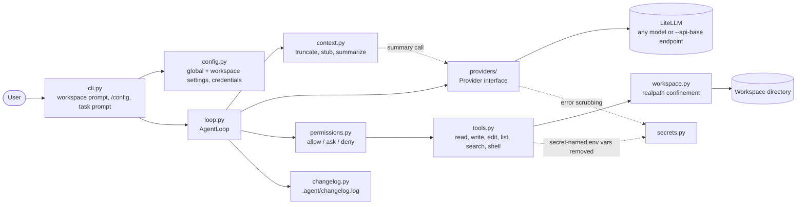
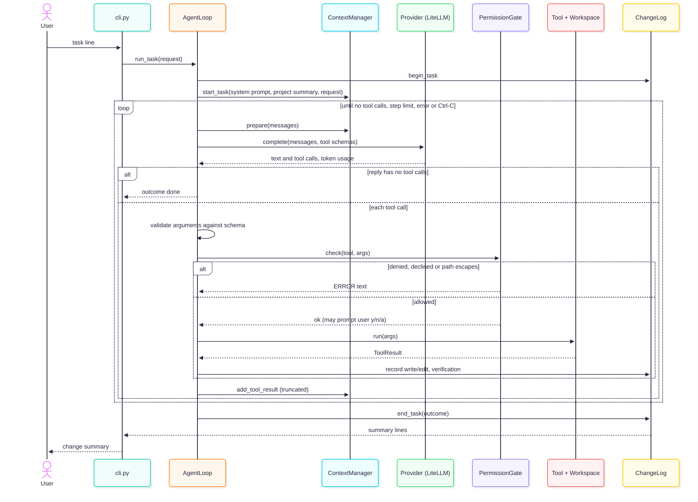
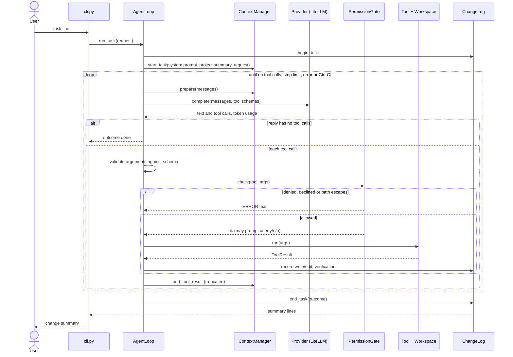
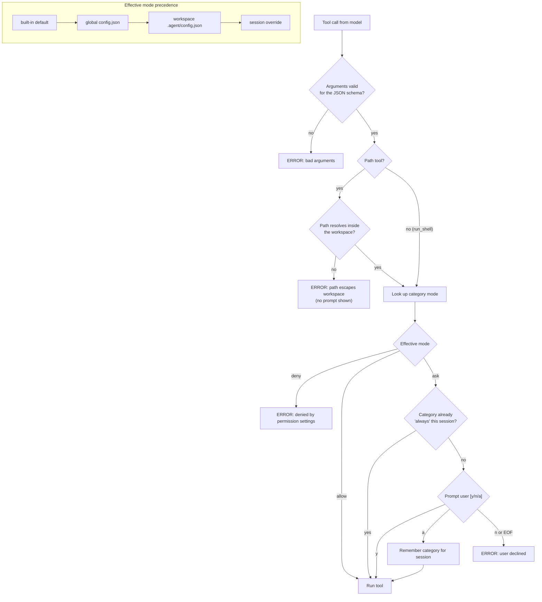
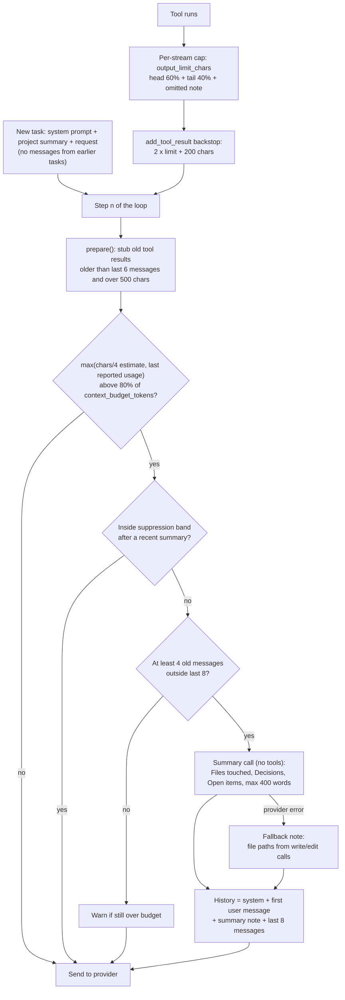
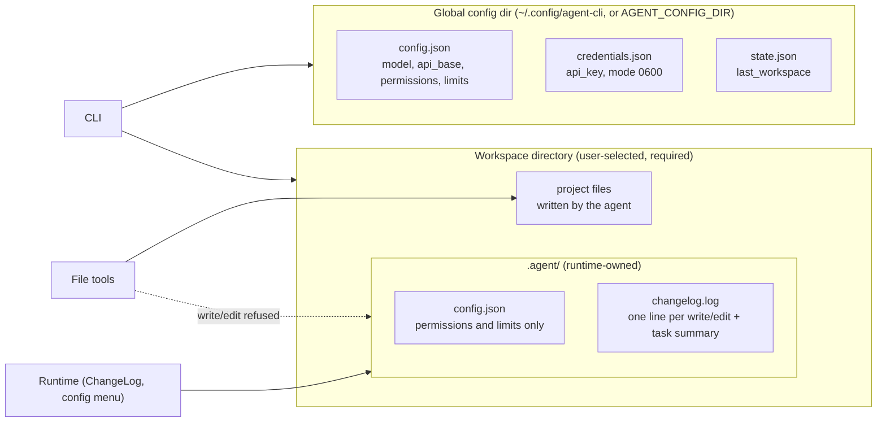

# Build Your Own AI Coding Agent: Technical Project Report

- **Course project:** Project 1, Build Your Own AI Coding Agent
- **Implementation:** Python 3.10+, `agent-cli` 0.1.0 (MIT licence)
- **Repository layout:** see section 5.8 and the [README](../README.md)

---

## Table of contents

1. Abstract
2. Introduction and goals
3. Background and related work
4. Requirements
5. System architecture
6. Implementation, component by component
7. Design decisions and tradeoffs
8. Security model and threat analysis
9. Testing and verification
10. Challenges
11. Learnings
12. Limitations and future work
13. References

---

## 1. Abstract

This project is a personal AI coding agent for the terminal. It starts from the basic agentic loop (call a model, execute the tool calls it requests, return the results, repeat) and adds the pieces needed to use it on a real project: a mandatory workspace directory with symlink-safe path confinement, six file and shell tools, a three-mode permission system (`allow`, `ask`, `deny`) configurable globally or per directory, per-task context management (truncation, stubbing of old results, summarization), a compact change log written by the runtime without extra model calls, and a Kiro-style task flow (understand, inspect, plan, execute, verify, report).

The agent is bring-your-own-key and model-agnostic. A small `Provider` interface isolates the agent core from LiteLLM, which supplies the first backend and reaches any hosted model or OpenAI-compatible endpoint (`--api-base`). The core never imports LiteLLM or the CLI; a test enforces this.

The implementation is about 1,750 lines of Python in `agent/` and 1,440 lines of tests. The offline suite has 147 passing tests, and a scripted end-to-end check with a stub provider passes 20 of 20 checks. A live proof-of-concept session ran through an OpenAI-compatible endpoint with real tool calling. In that session the agent wrote ten files for a browser extension from one prompt and then refined it over many follow-up tasks. The session also exposed real limits, which are reported in sections 9 to 12.

## 2. Introduction and goals

AI coding agents such as Claude Code, GitHub Copilot's agent mode and Cursor's agent mode let a language model read code, edit files and run commands on a developer's behalf. The assignment asks for a from-scratch implementation that starts simple and grows capability step by step, so that the building blocks are understood rather than borrowed from a framework.

Goals, in priority order:

1. **Understand the mechanics.** Write the loop, tool dispatch, permission checks and context handling by hand. No agent framework is used.
2. **Make it usable on real work.** The agent must create and edit files in a directory, run commands to verify its work, and survive long tasks.
3. **Keep the user in control.** The user chooses which operations are allowed, which need confirmation, and whether that choice is global or specific to one directory.
4. **Stay model-neutral.** The user supplies the API key and chooses the model.
5. **Leave an audit trail that is cheap in tokens.** Every change gets a short reason, written by the runtime and not by an extra model call.
6. **Be honest about limits.** Where a safeguard is partial, say so.

Non-goals for this version: streaming output, sub-agents, a sandboxed shell, an editor integration, and support for models without native tool calling.

## 3. Background and related work

The core idea predates these products. The ReAct pattern (Yao et al., 2022) interleaves model reasoning with actions and observations. Modern chat APIs make this practical through structured tool calling: the model returns a function name and JSON arguments, the host executes it and feeds the result back. Every agent below is a variation on that loop.

The comparison below is a summary of publicly documented behavior at the time of writing. Products change quickly, so the cells describe typical design emphasis and not exact feature lists. Check each product's documentation for current details (section 13).

| | Claude Code | GitHub Copilot (agent mode) | Cursor Agent | Kiro | This project |
|---|---|---|---|---|---|
| Surface | Terminal CLI (also editor integrations) | Inside VS Code and other IDEs, plus a cloud coding agent | Forked VS Code IDE, plus CLI | Agentic IDE and CLI | Terminal CLI |
| Model access | Anthropic models | Models offered through GitHub's service | Multiple providers through Cursor's service | Models offered through the Kiro service | Any model, user's own key, via LiteLLM |
| Main interaction | Conversational loop with tool use | Chat and agent edits in the editor | Chat, inline edits and agent runs | Spec-driven flow (requirements, design, tasks) and chat | One typed task per turn, phased flow |
| Permissions | Per-tool allow, ask, deny rules | Confirmation prompts for tools and commands | Approval settings for commands and edits | Trust and approval settings for tools | `allow`/`ask`/`deny` per category, global or per directory |
| Context handling | Automatic compaction of long sessions | Workspace indexing and context selection | Codebase indexing and context selection | Specs and steering files persist project context | Per-task fresh context, stubbing, summarization |
| Extensibility | Hooks, sub-agents, MCP | Extensions, MCP | Rules, MCP | Steering, hooks, MCP | None yet (section 12) |

What this project borrows:

- From **Claude Code**: a terminal-first loop with a permission prompt before risky tools, and compaction of long histories.
- From **Copilot and Cursor**: the idea that the agent should edit existing files by targeted change, not rewrite them wholesale.
- From **Kiro**: the visible, phase-by-phase task flow and a durable record of what was done and why.

What it deliberately does not attempt: indexing, a graphical editor, a hosted model service, or extension systems. Those are product features around the loop, not the loop itself.

## 4. Requirements

The requirements come from the project brief and the author's instructions.

**Functional**

| ID | Requirement | Where met |
|---|---|---|
| F1 | Python implementation, CLI interface | `agent/cli.py` |
| F2 | Bring your own API key; works with any model | `agent/providers/`, `agent/config.py` |
| F3 | Directory access, file creation, reading and writing | `agent/tools.py` |
| F4 | User must select a directory before any task runs | `select_workspace` in `agent/cli.py`, `agent/workspace.py` |
| F5 | Config menu: which operations are allowed, need permission or are denied, globally or per directory | `/config` menu, `agent/config.py`, `agent/permissions.py` |
| F6 | Context handling and management for each task | `agent/context.py`, task-scoped history in `agent/loop.py` |
| F7 | Clear project structure in the software the agent builds | Rules in the system prompt (`agent/prompts.py`) |
| F8 | Log of all changes with reasoning, written at the end of each task, not token heavy | `agent/changelog.py` |
| F9 | Kiro-like core agent flow | `agent/prompts.py`, `agent/loop.py` |

**Non-functional**

| ID | Requirement |
|---|---|
| N1 | Core logic is testable offline with no API key |
| N2 | File tools never touch paths outside the workspace, including through symlinks |
| N3 | No secret appears in provider error messages, shell child environments or the change log |
| N4 | Output of tools and history size are bounded so a task cannot exhaust memory or the context window silently |
| N5 | Documented limits where a safeguard is partial |

**Submission requirements** (from the assignment): a GitHub repository with clean, documented source; an explainer video; and this technical report with architecture diagrams.

## 5. System architecture

### 5.1 Overview


<details>
<summary>Mermaid source</summary>



</details>

The CLI is the only module that talks to the user. It selects the workspace, loads settings, builds a provider, gate, context manager, change log and loop for each task, and prints events. The loop is the only module that drives the model. Everything else is a service the loop calls.

### 5.2 Layering rule

`agent/providers/litellm_provider.py` is the only module that imports `litellm`. The core modules (`loop`, `tools`, `context`, `permissions`, `changelog`, `workspace`) do not import `cli` or `litellm`. `tests/test_boundaries.py` (6 tests) checks this. The consequence is that the loop, context manager and tools run against a scripted `FakeProvider` in tests, and LiteLLM could be replaced by writing another class with a `complete(messages, tools)` method.

### 5.3 Agent loop at runtime



<details>
<summary>Mermaid source</summary>



</details>

### 5.4 Permission resolution



<details>
<summary>Mermaid source</summary>



</details>

### 5.5 Context management pipeline


<details>
<summary>Mermaid source</summary>



</details>

### 5.6 Data and file layout



<details>
<summary>Mermaid source</summary>



</details>

The diagram sources are in `docs/diagrams/*.mmd`, with rendered `.svg` and `.png` files beside them. They were rendered with `npx -y @mermaid-js/mermaid-cli`.

### 5.7 Module map

| Module | Responsibility |
|---|---|
| `cli.py` | Workspace prompt, `/config` menu, `/workspace`, task prompt loop, event printing |
| `loop.py` | `AgentLoop.run_task`: model call, validation, gate, tool run, logging |
| `tools.py` | Tool schemas, implementations, argument validator |
| `permissions.py` | `PermissionGate` |
| `config.py` | Layered settings, validation, atomic saves, credentials, remembered workspace |
| `context.py` | Output truncation, stubbing, summarization, token estimate |
| `changelog.py` | Change log writer and project summary builder |
| `workspace.py` | Workspace validation and `resolve` (confinement) |
| `prompts.py` | System prompt and summarization prompt |
| `secrets.py` | One definition of "secret name", value collection, scrubbing |
| `providers/` | `Provider` protocol, `LiteLLMProvider`, `FakeProvider` |

### 5.8 Repository layout

```
agent/            source package (11 modules + providers/)
tests/            pytest suite, offline
scripts/e2e_check.py   offline end-to-end check with a stub provider
docs/             design-decisions.md, security.md, this report, diagrams/
.github/workflows/ci.yml   CI on Python 3.10 to 3.13 (not run locally)
pyproject.toml    package metadata; entry point `agent = agent.cli:main`
```

## 6. Implementation, component by component

### 6.1 Provider layer

`agent/providers/__init__.py` defines the whole contract the core needs:

- `ToolCall(id, name, arguments, raw_arguments)`
- `Response(text, tool_calls, usage_total_tokens)`
- `ProviderError`, carrying a one-line, already-scrubbed message
- `Provider`, a `typing.Protocol` with `complete(messages, tools) -> Response`

`LiteLLMProvider` implements it with `litellm.completion`. Details that matter:

- **Tool-call parsing.** Arguments arrive as a JSON string. If it does not parse to an object, the call is kept with `{"__parse_error": raw}`, and the loop returns an error result for that call so the model can retry. The raw string is preserved and sent back unchanged in the assistant message so histories stay valid.
- **Error mapping.** `map_exception` converts LiteLLM exception classes to fixed messages such as `auth failed for model X`, `rate limited by provider for model X` and `context window exceeded for model X`. The text of the original exception is never used, because provider errors sometimes echo request details. Unknown exceptions become `provider error (<ClassName>) for model X`.
- **Scrubbing.** The final message is passed through `secrets.scrub` with the explicit key and every secret-named environment value.
- **Preflight.** Before a task starts, `preflight` reports missing credentials, unless a key or `api_base` is set. A custom `api_base` skips the check because some local servers need no key.
- **Summaries.** The context manager calls the same provider with an empty tool list. `LiteLLMProvider` does not forward `tools` when the list is empty.

`FakeProvider` returns scripted `Response` objects (or raises scripted exceptions) and records each call. It drives the loop, flow and e2e tests.

### 6.2 Agent loop

`AgentLoop.run_task` (in `loop.py`) does the following.

1. Read the project summary from the change log, then `begin_task`. The order keeps the current task out of its own summary.
2. Build a fresh history: system prompt, then a user message containing the project summary and the task.
3. For each step up to `max_steps` (default 25): call `context.prepare`, call the provider, record token usage, append the assistant message, and print any text.
4. If the reply has no tool calls, the task is `done`. Otherwise execute each call in order.
5. `_execute` checks, in order: tool exists, arguments parsed, arguments match the schema, then the permission gate, then runs the tool inside a `try`. Any exception becomes an `ERROR:` tool result. Failures never crash the loop; they go back to the model as data.
6. Only successful `write_file` and `edit_file` calls are logged as changes. `run_shell` results feed a verification record (exit code only).

A task ends with one of five outcomes: `done`, `step_limit`, `provider_error`, `interrupted` or `internal_error`. In every case `end_task` runs from a `finally` block, so the summary is always produced. On Ctrl-C, tool calls that did not run get an `ERROR: interrupted by user` result so the history stays well formed.

### 6.3 Tools

| Tool | Category | Behavior and limits |
|---|---|---|
| `read_file` | read | Optional `start_line` and `end_line`. Output lines are prefixed `N<TAB>`. Files over 1 MB need a range. Refuses binary files (NUL in the first 8 KB). Output is truncated to `output_limit_chars` (default 8000). |
| `write_file` | write | Creates parent directories. Refuses directories, content over 1 MB and anything under `.agent/`. |
| `edit_file` | edit | Replaces exactly one occurrence of `old_text`. Fails on zero matches or more than one. Reads bytes and refuses binary or non-UTF-8 files. Refuses `.agent/`. |
| `list_dir` | read | Non-recursive, directories end with `/`, at most 200 entries, hides `.agent` at the root. |
| `search` | read | Python regex over files, optional glob, at most 100 matches, skips `.git`, `.agent`, `.venv`, `node_modules`, large and binary files, does not follow directory symlinks, and re-resolves every candidate file. |
| `run_shell` | shell | Runs with the workspace as working directory, stdin closed, timeout (default 60 s, capped by the setting), and a filtered environment. |

Design points:

- **Tiny schema validator.** `validate_args` checks required keys and primitive types, which is all the six schemas need. It rejects booleans where integers are expected.
- **Reasons.** `write_file`, `edit_file` and `run_shell` take a one-sentence `reason`, capped at 200 characters. This is how the log gets its explanations without a second model call.
- **Edit errors teach.** The "not found" and "matches N times" messages tell the model what to do next (re-read the file, add context). The live run shows this working (section 9.4).
- **Bounded shell output.** Reader threads drain stdout and stderr into a head-and-tail buffer of four times the output limit, so a command that prints gigabytes cannot exhaust memory. The result then goes through `truncate_output`.
- **Process-group kill.** The shell runs in its own session. On timeout, or on Ctrl-C (any `BaseException`), the whole process group gets SIGKILL and the exception is re-raised. This was added after review (section 10).

### 6.4 Workspace and path safety

`Workspace.validate` resolves the user's path with `realpath` and requires it to exist and be a directory. `Workspace.resolve` is the single confinement check:

1. Reject non-strings, empty strings and strings containing NUL.
2. Join relative paths to the root.
3. Call `os.path.realpath`, which follows symlinks and removes `..`.
4. Accept only the root itself or a path with the root among its parents; otherwise raise `PathEscapeError`.

Because the check runs on the resolved path, these all fail: `../x`, an absolute path elsewhere, a symlink to a file outside, a symlink to a directory outside, and a new file under a symlinked directory. Every file tool, the permission gate and the search walker call `resolve`. In the gate, an escaping path returns an error before any prompt is shown, so the user is never asked to approve something that would fail anyway.

The CLI will not accept a task until a valid directory exists. It offers the last directory (stored in `state.json`) with Enter, re-prompts on a missing path or a file, and exits with code 1 on end of input.

### 6.5 Permission system and configuration scopes

Four categories exist: `read`, `write`, `edit`, `shell`. Each has a mode: `allow`, `ask` or `deny`. Defaults: `read` allow; the other three ask.

`PermissionGate.check` returns `(allowed, message)`:

1. Path tools: resolve the path (escape means error, no prompt) and build the prompt text, for example `write_file (overwrite): src/app.py (reason)`.
2. `deny` returns an error without prompting. `deny` is checked before any session grant.
3. `allow` runs. For `ask`, a category granted with `a` earlier in the session runs without a prompt.
4. Otherwise it prompts `[y/n/a]`. `y` runs once, `a` runs and remembers the category for the session, anything else (including end of input) declines.

Settings come from four layers, later ones winning per key: built-in defaults, the global file (`~/.config/agent-cli/config.json`, or `$XDG_CONFIG_HOME`, `%APPDATA%`, `$AGENT_CONFIG_DIR`), the workspace file (`<workspace>/.agent/config.json`), and command-line flags or session overrides. The `/config` menu shows each category's mode and where it came from (`default`, `global`, `workspace`), and asks whether to save a change globally or to the current workspace. Saves are atomic (write a temporary file, then `os.replace`), and a corrupt file is never overwritten.

Trust rule for workspace files: a cloned repository can ship its own `.agent/config.json`. That file cannot set `model`, `api_base` or an API key (global only), so it cannot redirect the user's key to another host. If it loosens a permission compared with the user's own settings, the CLI asks once per workspace per session (`[y/N]`) and ignores the loosening on a "no". The answer is not stored.

Other settings: `max_steps` (25), `shell_timeout_s` (60), `output_limit_chars` (8000), `context_budget_tokens` (60000). Each has a validated range.

### 6.6 Context management

Each task starts from scratch: the system prompt, and one user message with a project summary and the request. The summary is capped at 1,500 characters and holds the workspace name, up to 30 top-level entries and the last three task titles with their outcomes, taken from the change log. This is the only thing carried across tasks, which keeps a long session from accumulating stale history.

Within a task, `ContextManager` applies four layers.

1. **Truncate at the source.** Tool outputs are cut to `output_limit_chars` using 60% head and 40% tail with a note of how much was omitted. `add_tool_result` adds a backstop of `2 x limit + 200` characters.
2. **Stub old results.** Before each call, tool results older than the last six messages and longer than 500 characters are replaced by a one-line stub holding the tool name, the first 80 characters and the original length. Stubbing is idempotent.
3. **Summarize near the limit.** The size estimate is the larger of a four-characters-per-token estimate and the last token total reported by the provider. When it exceeds 80% of `context_budget_tokens`, the manager asks the model (with no tools) to write a note of at most 400 words with the headings *Files touched*, *Decisions* and *Open items*. The history becomes: system prompt, the first user message, the summary note, and the last eight messages. The cut point moves back so an assistant `tool_calls` message is never separated from its results.
4. **Degrade safely.** If the summary call fails, a fallback note lists file paths taken from `write_file` and `edit_file` calls. If the history is still over 80% after summarizing, a suppression band at 1.2 times the new size prevents summarizing again on every step. If it is over the budget outright, the user gets one warning.

The full record of changes is on disk in the change log, so a lossy summary does not lose the audit trail.

### 6.7 Change log

The runtime writes `<workspace>/.agent/changelog.log`. No model call is involved. This real output comes from the offline e2e check (section 9.3):

```
# task 2026-11-20T01:36:44 | build a demo
2026-11-20T01:36:44 | write | src/app.py | create module
2026-11-20T01:36:44 | write | tests/test_app.py | add test
2026-11-20T01:36:44 | edit | src/app.py | bump value
#> Task done: 3 change(s)
#>   tests/test_app.py: add test
#>   src/app.py: bump value
#> verify: 1 shell run(s), last exit 0
# end 2026-11-20T01:36:44 done | 3 changes
```

Rules:

- One line per successful `write_file` or `edit_file`: timestamp, action, relative path, reason (one line, no pipe characters, at most 200 characters, or `(none given)`).
- No diffs, no reads, and no shell command text. Commands appear only in memory and in the terminal summary. The file records a count of shell runs and the last exit code.
- The end-of-task block lists at most eight files, with the last reason for each, then `+N more`, and at most four verification entries on the terminal. The e2e check measured 380 characters for a three-change task.
- Tasks have unique identifiers (a repeated timestamp gets a `#2` suffix), and an unfinished task is shown as `unfinished` in the next project summary.
- A write failure is reported once as a warning and does not stop the agent.

### 6.8 Kiro-style flow prompt

`SYSTEM_PROMPT` (about 250 words) tells the model to work through six phases in order:

1. **Understand:** restate the goal in one sentence.
2. **Inspect:** use `list_dir`, `search` and `read_file` before changing anything.
3. **Plan:** a numbered plan of at most seven short steps, as plain text, before the first `write_file`, `edit_file` or `run_shell`.
4. **Execute:** prefer `edit_file` for existing files, one change per call, always with a short `reason`.
5. **Verify:** run tests or the program, and fix failures.
6. **Report:** a short summary with no tool calls, which ends the loop.

Further rules cover clean structure (source in a package or `src/`, tests in `tests/`), not repeating file contents in replies, how to react to `ERROR` results, and a note that the `N<TAB>` prefix from `read_file` must be left out when copying text into `old_text`. The flow is enforced by instruction, not code. The code guarantee is the loop's termination rule (a reply without tool calls ends the task) and the always-written summary. `tests/test_flow.py` checks, with the fake provider, that the plan text comes before the first write, that a result follows each tool call, and that the log contains exactly the write and edit lines.

## 7. Design decisions and tradeoffs

The full reasoning is in `docs/design-decisions.md`. This section condenses it and notes where the implementation went further.

| # | Decision | Alternatives | Why this one | Cost |
|---|---|---|---|---|
| 1 | **Python** | TypeScript | Official SDKs everywhere, minimal setup (`python -m agent`), the goal is the loop, not the language | Optional typing only; TypeScript would suit an editor extension better |
| 2 | **Own `Provider` interface, LiteLLM first backend** | One provider; one adapter per provider | Any model from day one; core independent of LiteLLM | One extra abstraction layer; a large dependency |
| 3 | **CLI** | Web UI, editor extension | Lowest effort, native filesystem and shell, matches the target tools | No rich UI; plain `input()` prompts |
| 4 | **Hand-written loop, native tool calling** | LangChain-style framework; text parsing | The loop is small and is what the project teaches; structured calls are reliable | Some plumbing is ours; models without tool support are out of scope |
| 5 | **Six small tools, exact search-and-replace edit** | Many tools; whole-file rewrite | Fewer tools mean easier selection and fewer prompt tokens; rewrites waste tokens and can drop code | An edit fails when the match is not unique, so errors must be clear |
| 6 | **Mandatory workspace** | Free access to the whole disk | Bounded blast radius, per-directory config and log | An extra startup step; the shell can still leave the directory |
| 7 | **`allow`/`ask`/`deny` per category with global and workspace scope** | Ask every time; trust everything | Strict in unfamiliar projects, relaxed in your own | More config code and a precedence rule |
| 8 | **Layered context management, per-task history** | Send full history every call | Lower cost, fewer context-limit failures | Summaries lose detail; the change log keeps the record |
| 9 | **Runtime-written, compact change log with model-supplied reasons** | Ask the model to write a narrative afterward | No extra tokens, cannot drift from what happened | Reasons are brief; it does not replace git |
| 10 | **Phased flow in the prompt** | Free-form tool use | Visible plan and verification, fewer wandering calls | Small planning overhead; relies on the model following the prompt |
| 11 | **Thin vertical slices** | Design everything first | A working system early; no speculative abstraction | Some rework when a later slice reveals a gap |

Decisions made during implementation that go beyond the original notes:

- **Workspace config cannot set `model`, `api_base` or keys,** and loosened permissions need a one-time confirmation. This came out of the design review (section 10).
- **Shell command text never reaches the log file.** An early design draft appended command text to the summary lines in the log; review flagged this, and the final code writes only a count and exit code.
- **Environment filtering for the shell** removes variables whose names look secret, so a command run by the model cannot print them.
- **Errors from providers are mapped, not forwarded,** because forwarded text can include request details.

## 8. Security model and threat analysis

The tool is a local, single-user program that runs model-chosen actions with the user's rights. The relevant question is what a wrong, confused or manipulated model (for example one reading a malicious file in the workspace) can do.

### 8.1 Assets and threats

| Asset | Threat | Mitigation | Residual risk |
|---|---|---|---|
| Files outside the workspace | Model asks a file tool for `../x`, an absolute path, or a symlink target | `Workspace.resolve` uses `realpath` and a containment check, applied by every file tool, the gate and the search walker | Check-then-use race: a symlink swapped between the check and the use is not defended against |
| Anything the user can reach | Model runs `run_shell` with a harmful command | Permission gate (default `ask`), workspace as cwd, timeout, process-group kill | **The shell is not a sandbox.** An approved command runs with the user's rights and can read or write anywhere |
| API key | Key leaks to the shell child, to logs, to terminal output, or to another host | Child environment excludes secret-named variables; provider errors use fixed messages and are scrubbed; `credentials.json` has mode 0600 and a warning if wider; `api_base` and `model` are global only | Filtering is by variable name, so a key stored under an unusual name still reaches the child. Scrubbing is exact-match, so a masked fragment echoed by a provider is not matched |
| User's permission settings | A cloned repository ships `.agent/config.json` that sets `shell=allow` | Loosening requires a per-session `y/N` confirmation; workspace file cannot set model, `api_base` or keys | The user may answer yes without reading |
| Agent runtime state | Model overwrites `.agent/config.json` or the change log | `write_file` and `edit_file` refuse `.agent/` paths (case-insensitive on macOS and Windows) | A shell command can still change that directory. This guard prevents accidents, not attacks |
| Change log integrity and secrets | Key placed in a reason, or command text persisted | Shell command text is never written; reasons are single-line and capped at 200 characters | A model could put a key into a `reason`; reasons are not scrubbed. The log is gitignored |
| Memory and context | Huge outputs or very large files | 1 MB file cap, head and tail output buffers, truncation, stubbing | Estimates use four characters per token |
| Availability | Runaway loop | Step limit of 25 model calls, shell timeout, Ctrl-C support | A model can use all 25 steps without finishing (it happened; section 9.4) |

### 8.2 The shell is not a sandbox

This is the largest accepted risk, and the documentation says it in `docs/security.md` and the README. A line such as `cat ~/.ssh/id_rsa` is a valid command, and the gate cannot tell safe from unsafe commands. The mitigations are all about the human: the default is `ask`, the prompt shows the command and the model's reason, and `deny` is available per directory. Real isolation needs a container, a restricted user or a sandbox profile (section 12).

### 8.3 Symlink escapes

A plain prefix check on the path string would let `repo/link` (a symlink to `/etc`) pass. Resolving first and checking the real path closes that hole. The same applies to new files created under a symlinked directory, because the parent resolves outside the root. The `search` tool needed a separate fix: `os.walk` lists symlinked files without resolving them, so each candidate file is re-resolved and skipped when it leaves the workspace. Tests cover `..`, absolute paths, file and directory symlinks, symlinked parents and a symlinked workspace root. The e2e check confirms the outside file stays unchanged.

### 8.4 Secret scrubbing

`agent/secrets.py` holds the one definition of a secret name (suffixes such as `_KEY`, `_TOKEN`, `_SECRET`, `_PASSWORD`, plus exact names such as `AGENT_API_KEY`). It is used twice: to build the shell child's environment and to collect values to scrub from provider errors. Values shorter than eight characters are ignored, so scrubbing cannot corrupt ordinary text. Names such as `SSH_KEY` are stripped too, which can break commands that need them; this is a known tradeoff.

### 8.5 Prompt injection

File contents are data, but a model reading a hostile file may follow instructions in it. The agent has no network tool, and every write, edit and shell call is gated, so a successful injection still needs the user's approval or a permissive setting. The mitigation is the permission default, not content filtering. Setting `write`, `edit` or `shell` to `allow` in a directory that contains untrusted files raises the risk accordingly.

## 9. Testing and verification

All commands below were run against the final code on macOS with the project virtual environment (Python 3.14.8, LiteLLM 1.109.1, pytest 9.2.0).

### 9.1 Unit and integration tests

`pytest -q` result: **147 passed**, offline, no API key, about 6 seconds.

| File | Tests | Covers |
|---|---|---|
| `test_workspace.py` | 8 | `..`, absolute paths, symlinks to outside files and directories, symlinked parent of a new file, symlinked root, NUL and empty paths, validation errors |
| `test_tools.py` | 31 | Each tool's success and failure, edit refusing latin-1 and NUL files, multibyte UTF-8 preserved, Ctrl-C killing the shell process group, bounded shell output |
| `test_permissions.py` | 7 | allow, ask (yes, no, always, end of input), deny, no prompt on path escape, overwrite versus write |
| `test_config.py` | 16 | Precedence per key and category, workspace isolation, persistence, corrupt files, invalid values, global-only keys, loosening warnings, key resolution, mode 0600 |
| `test_context.py` | 13 | Truncation bounds, stubbing, summarize trigger and structure, no repeated summarizing, fallback on provider error, new task excludes old messages |
| `test_changelog.py` | 13 | Line format, sanitizing, `(none given)`, no reads or shell lines, secret and command text absent, unfinished tasks, 15-line summary, project summary cap |
| `test_loop.py` | 20 | Scripted tool calls, step limit, provider error, bad arguments, parse errors, raw argument round trip, interrupt, ask and always and deny, failed edits not logged |
| `test_flow.py` | 2 | Plan before first write, result after each tool call, summary last |
| `test_provider.py` | 10 | Exception mapping with real LiteLLM classes, empty tools not forwarded, key scrubbing, preflight |
| `test_secrets.py` | 13 | Name detection, value collection, scrubbing |
| `test_cli.py` | 8 | Workspace re-prompt, remembered path, bad flag, end of input |
| `test_boundaries.py` | 6 | Core modules do not import `cli` or `litellm` |
| **Total** | **147** | |

`tests/conftest.py` clears secret-looking environment variables so a developer's real key can never be used by a test.

### 9.2 Package and CI

`pip install -e ".[dev]"` succeeds. `.github/workflows/ci.yml` runs pytest and the e2e check on Python 3.10 to 3.13. It has not been run on a GitHub runner; only Python 3.14 on macOS was exercised locally. Windows is untested.

### 9.3 Scripted end-to-end check

`scripts/e2e_check.py` drives the real loop, tools, gate, config, change log and CLI with a stub provider in a temporary workspace. Result: **20 of 20 checks passed**.

- Two files created with `write_file`, one edited with `edit_file`, one command run with `run_shell`.
- Permissions: `allow` gives no prompts; with `ask`, declined writes are not performed and approved writes are; `deny` blocks without prompting.
- Escapes: `../escape.txt`, symlinked file read and write, and a symlinked directory write are all rejected with `path escapes workspace`, and the outside file is unchanged.
- Config: workspace `shell=ask` overrides global `deny`, and global values still apply elsewhere.
- Change log: every write and edit line has a reason; the summary and `# end` line are present; the log was 380 characters for three changes; a unique marker inside the shell command never appears in the file.
- CLI: with no directory (end of input) it exits without running a task; a nonexistent directory is rejected and the next input line is treated as another directory attempt.

### 9.4 Live proof-of-concept run

The offline tests cannot show whether a real model drives the tools well, so the agent was also run against a real model through an OpenAI-compatible endpoint. The endpoint was reached with `--api-base` and a model name with the `openai/` prefix, so LiteLLM used the OpenAI chat protocol:

```
export AGENT_API_KEY=<key the endpoint expects>
python -m agent --api-base http://localhost:8000/v1 --model openai/<model-id>
```

The model behind the endpoint was `claude-sonnet-4.5`. This was a demonstration setup only; the agent itself depends on nothing specific to this endpoint. Model calls took roughly 5 to 9 seconds each in these runs (an informal observation, not a benchmark, and it depends on the endpoint as much as on the agent).

Two live runs are relevant:

- An earlier session had the agent build a small command-line to-do application (`todo.py` storing tasks in `todo.json`, with a README), working through real tool calls.
- The recorded session, kept in [`Test run.md`](../Test%20run.md), started in that workspace. It is a raw terminal transcript and the source of the excerpts below.

**Boundaries.** The first requests were harmless but useful:

```
> okay, what directory are you in?
-> run_shell pwd
run_shell: pwd  (Check current working directory) [y/n/a]: y
   ok
...
Task done: 0 change(s)
  verify: pwd -> exit 0
> go to this directory /Users/home
-> list_dir /Users/home
   ERROR: path escapes workspace: /Users/home
```

The shell command stopped at the permission prompt, and the out-of-workspace path was refused by tool code, not by the model.

**A real task in phases.** The user asked for a browser extension that hides interactive elements on three websites, plus an architecture document. The agent printed the phases, wrote a seven-step plan, and then called the tools. After one `a` answer at the first write prompt, the remaining writes ran without prompts:

```
## 3. Plan
1. Create extension directory structure with manifest.json for Chrome/Firefox compatibility
...
## 4. Execute
-> write_file browser-extension/manifest.json
write_file (write): browser-extension/manifest.json  (Create manifest.json for browser extension ...) [y/n/a]: a
   ok
-> write_file browser-extension/content-scripts/instagram.js
   ok
```

It then verified with `find`, a JSON validity check and a syntax check of each script. The end-of-task summary, printed from the change log data, was:

```
Task done: 10 change(s)
  browser-extension/manifest.json: Create manifest.json for browser extension with content scripts for each platform
  browser-extension/content-scripts/instagram.js: Create Instagram content script to identify and block interactive elements
  ...
  +2 more
  verify: find browser-extension -type f | sort -> exit 0
  verify: cd browser-extension/content-scripts && for file in *.js; do node -c "$file" 2>& -> exit 0
```

**Iteration.** The user then tried the extension in a browser and gave feedback over about a dozen tasks. Each was a new task with fresh context and the short project summary. Results from the transcript:

| Outcome line | Meaning |
|---|---|
| `Task done: 10 change(s)` | Initial build |
| `Task done: 4 change(s)`, `Task done: 2 change(s)` | Feedback rounds (feed hiding, search bar) |
| `Task done: 1 change(s)` | The agent found that its own element-removal code had broken the search bar and removed it |
| `[error] stopped after 25 steps` then `Task step_limit: 11 change(s)` | Step limit reached on a hard debugging request; the 11 changes made were still summarized |
| `Task done: 0 change(s)` | Read-only turns, such as when the user asked a question and said to change nothing |
| `Task done: 2 change(s)` | Final documentation update to match the code |

**Recoverable errors.** The exact-match edit tool refused edits when the model's text was stale or ambiguous, and the model recovered:

```
-> edit_file browser-extension/manifest.json
   ERROR: old_text not found in browser-extension/manifest.json. Re-read the file and copy the text exa
-> read_file browser-extension/manifest.json
   ok
-> edit_file browser-extension/manifest.json
   ok
```

A similar error (`old_text matches 19 times in ... youtube.js`) appeared once, and the model supplied more context in the next call.

**What the run showed about weaknesses.**

- When asked where the extension was built, the model correctly ran `pwd`, but its prose then named two files (`background.js`, `icon.png`) that were never created. The tool calls and permission checks were correct; the model's final text was not. The tool layer does not check claims in prose.
- The verification the agent chose was syntax-only (`node -c`, JSON validation). This cannot show that an extension behaves correctly on live sites. Several rounds of user feedback were needed because of this.
- The 25-step cap stopped one task that was still making progress. The cap is configurable (`--max-steps`) and the stop was reported clearly.
- Pressing Ctrl-R at the prompt put control characters into the input, and they were sent to the model as task text. A guard against lines containing only control characters is future work.
- Some model replies contained placeholder text unrelated to the task. This came from the model or the endpoint, not the agent's code.

`Test run.md` was reviewed before publishing: it contains no credentials, only local paths and the model name. The extension itself was not tested on the live sites by the agent.

## 10. Challenges

### 10.1 Design review loop

The design went through repeated written reviews before coding, with each round producing findings that were fixed. By the third round the reviewer's concerns were about consistency between design sections and the stated security properties:

1. **Contradiction about shell commands in the log.** One section said commands are never persisted, but the summary lines (which the design appended to the log) included command text. Fix: commands appear only in the terminal summary and in memory; the log gets a count and the last exit code. A test asserts that a command containing `sk-SECRET` never appears in the log file.
2. **`search` could read outside the workspace.** `os.walk` does not enter symlinked directories but does list symlinked files, so a file link to an outside secret could be read and its matching lines returned. Fix: re-resolve every candidate and skip failures, with a test using an outside symlink.
3. **Provider errors were under-specified,** and scrubbing covered only an explicit key. A key supplied by a provider environment variable would not be scrubbed. Fix: a defined mapping from exception classes to fixed messages, never including the exception text, plus scrubbing of every secret-named environment value.

Smaller items in the same review became design text or tests: a one-time confirmation before honoring a cloned repository's looser permissions, a note to check whether LiteLLM installs on Python 3.14, a single credentials format with empty keys treated as unset, a float-slice bug in the truncation spec, a system prompt line about the `N<TAB>` read prefix, and two undefined CLI and config cases.

### 10.2 The non-UTF-8 edit corruption bug

Code review of the first implementation approved most behavior and found one blocking defect. `edit_file` read files with a lenient decode that replaced undecodable bytes. A file in latin-1 would be edited and written back as UTF-8 with replacement characters, silently destroying its content. Fix: read bytes, refuse files that contain NUL in the first 8 KB or that fail strict UTF-8 decoding, and leave the file untouched. Tests cover latin-1, NUL-containing files and valid multibyte UTF-8. The review also caught three non-blocking issues, all fixed in the same commit:

- Ctrl-C during `run_shell` left the child process running (it is in its own session, so the terminal's interrupt does not reach it). The fix kills the process group and re-raises.
- Shell output was buffered without bound. The fix drains pipes into head-and-tail buffers.
- `docs/security.md` mentioned a debug log that did not exist. The sentence was removed.

The re-review approved the result, with two accepted non-blocking notes: `reason` text is not scrubbed before it reaches the change log, and Windows and Python 3.10 were untested. A third known gap is that `write_file` and `edit_file` truncate and rewrite in place, so a crash mid-write could leave a partial file.

### 10.3 The scripted-stdin mistake

Testing an interactive CLI with piped input exposed an assumption error. When a scripted stdin supplies a bad directory followed by a task line, the task line is not run as a task. The CLI consumes it as another directory attempt, because no workspace has been accepted yet; the e2e output shows `Workspace directory (required): directory does not exist: build something`. The mistake was in the script's assumption, not in the CLI, whose behavior is what requirement F4 asks for. The e2e check now asserts it: a rejected directory never leads to a task, and the following line is read as a directory.

### 10.4 Other challenges

- **Keeping the log small but useful.** Early thinking favored a narrative generated by the model. Moving to model-supplied one-sentence reasons per call gave the same information for no extra tokens.
- **Where to draw the line on summarizing.** Summarizing only when the estimate crosses 80% of the budget, and suppressing repeats, avoids paying for a summary call on every step once the history is large.
- **Model variance.** The same prompt produced consistent tool use but variable prose accuracy. See section 9.4.

## 11. Learnings

- **The loop is small; the guard rails are most of the work.** The model-call-and-dispatch core is about 140 lines. Path confinement, permissions, bounded output, interruption handling and context control together took much more code and nearly all the review findings.
- **Treat model output as untrusted input.** Arguments are validated, paths are resolved, and every failure becomes a readable error result. The model recovers from clear errors surprisingly well.
- **Put guarantees in code, not in the prompt.** The prompt asks for a plan and a summary, but only code can guarantee the workspace boundary, the log and the permission check. The live run followed the phases, yet its final prose still contained false claims.
- **Design reviews pay off.** Several defects (secrets in the log, symlink reads through `search`, unscrubbed provider errors) were fixed on paper before they existed in code.
- **Test the seam, not the model.** The `Provider` interface and `FakeProvider` made the loop, flow, context and permission behavior testable offline and deterministic.
- **Exact-match editing is a good fit for models.** Failures were cheap and informative, and the retry usually worked.
- **Verification quality limits agent quality.** An agent that can only check syntax will ship plausible but unproven code. Better verification tools matter as much as a better model.
- **Honest documentation is part of the product.** Writing the limits down (shell, race conditions, name-based filtering) clarified which ones to fix next.

## 12. Limitations and future work

**Current limitations**

- `run_shell` is not a sandbox.
- No streaming; replies appear when each model call finishes.
- Models without native tool calling are not supported.
- Context summarization can lose detail, and token counts are estimates (four characters per token) unless the provider reports usage.
- Changes are not transactional: file writes truncate in place.
- Tested with scripted providers plus short live sessions on one model; real behavior depends on the model's tool-calling quality. Only macOS with Python 3.14 was exercised locally.
- Verification is whatever the model chooses to run; the agent cannot drive a browser or other GUI.
- `reason` text is not scrubbed before it is written to the log.

**Future work**

| Item | What it would add |
|---|---|
| Streaming output | Lower perceived latency; the 5 to 9 second waits seen in the live run would show progress |
| Sandboxed shell | Run commands in a container or restricted profile so `allow` becomes safe |
| Sub-agents | Isolated contexts for exploration or parallel work, returning short summaries |
| MCP and plugin tools | Add tools such as a browser driver, a database client or documentation lookup without changing the core |
| Better summarization | Structured memory (decisions, open items) with checks that file paths still exist, and a real tokenizer for budgets |
| A network permission category | Gate fetch and web search tools the same way as the other categories |
| Evaluation harness | A set of fixed tasks with automated pass or fail checks, run against several models to measure completion rate, step count and token cost |
| Atomic writes and undo | Write to a temporary file then rename, with a per-task rollback built from the log |
| Input hygiene | Ignore lines made only of control characters; scrub reasons before logging |
| Task-adaptive step limit | Warn near the cap and offer to continue |

## 13. References

1. Yao, S. et al. *ReAct: Synergizing Reasoning and Acting in Language Models.* 2022. https://arxiv.org/abs/2210.03629
2. Anthropic. *Claude Code documentation.* https://docs.anthropic.com/en/docs/claude-code/overview
3. GitHub. *GitHub Copilot documentation.* https://docs.github.com/en/copilot
4. Cursor. *Cursor documentation.* https://docs.cursor.com
5. Kiro. *Kiro documentation.* https://kiro.dev/docs/
6. LiteLLM. *LiteLLM documentation.* https://docs.litellm.ai/
7. OpenAI. *Function calling guide* (the tool-calling message format that OpenAI-compatible endpoints follow). https://platform.openai.com/docs/guides/function-calling
8. Mermaid. *Mermaid diagramming syntax and CLI.* https://mermaid.js.org/
9. This repository: `README.md`, `docs/design-decisions.md`, `docs/security.md`, `scripts/e2e_check.py`, `tests/`, and `Test run.md` (live session transcript).
