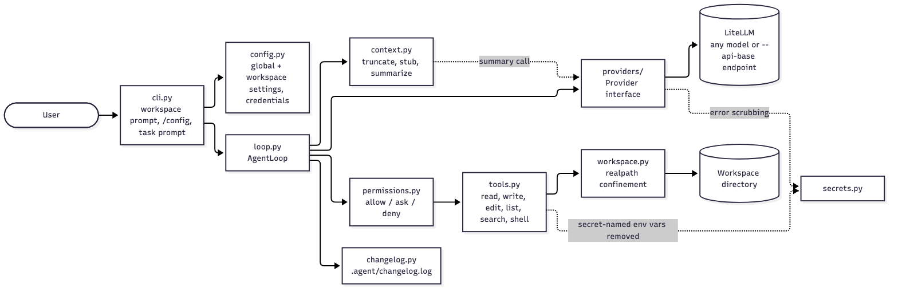
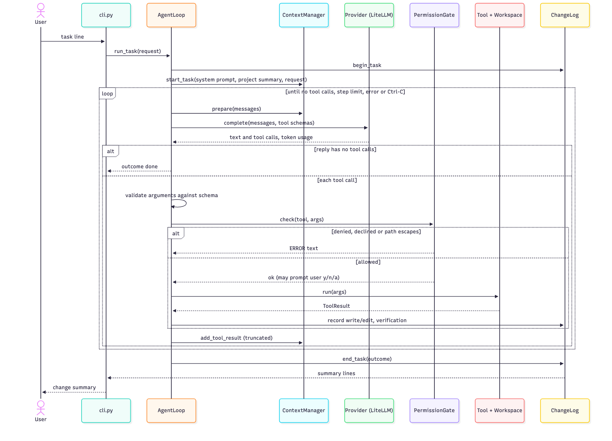
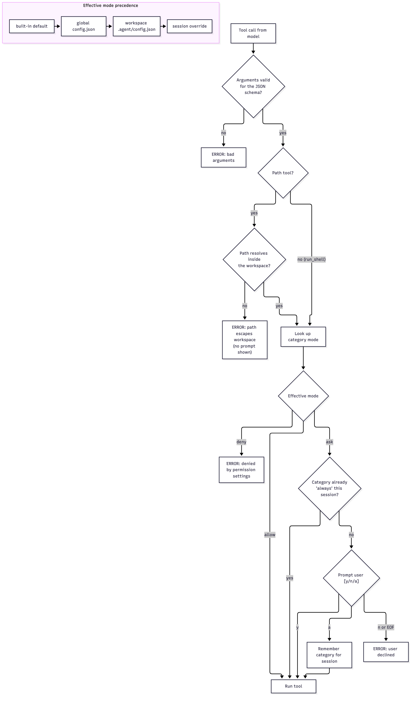
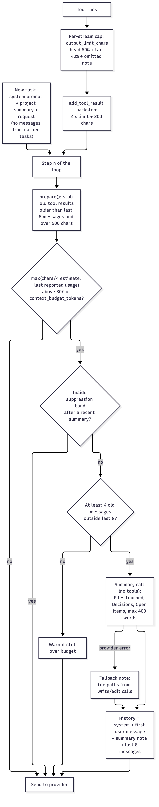
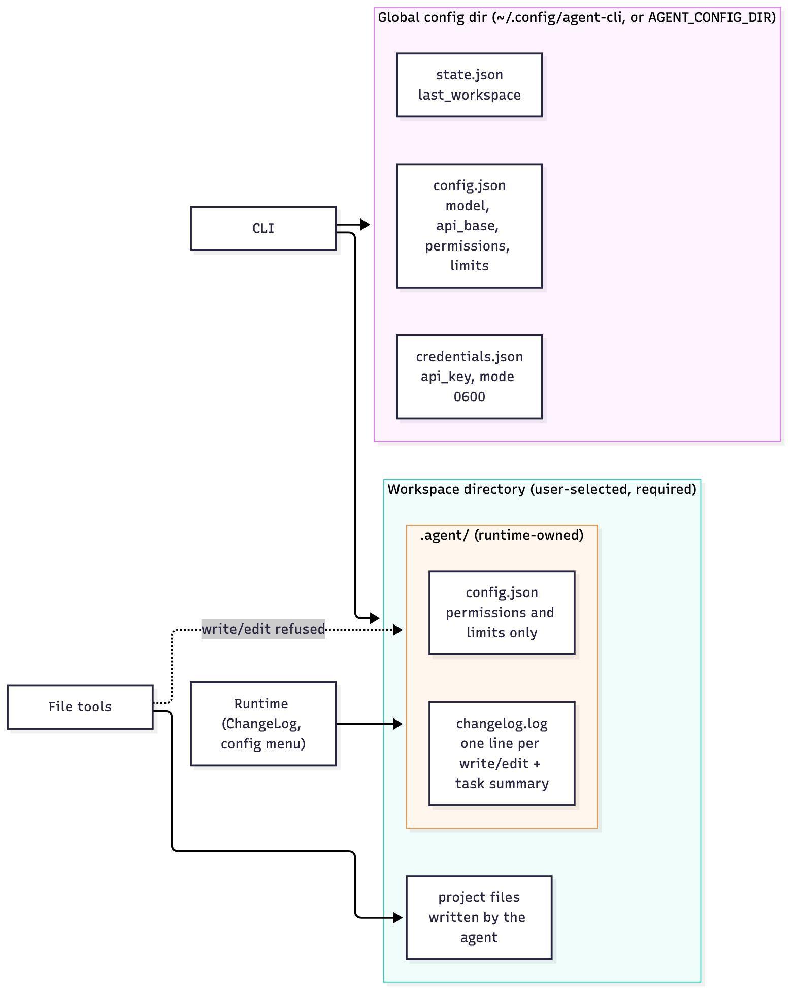

# Build Your Own AI Coding Agent

A bring-your-own-key coding agent for the terminal, in Python

Project 1 submission

---

# Concept

- Type a task in plain English; the agent builds software in a directory you choose
- Tools: read, write, edit, list, search, run shell
- Any model through LiteLLM, or any OpenAI-compatible endpoint with `--api-base`
- Kiro-style flow: understand, inspect, plan, execute, verify, report
- You decide what is allowed, what asks first, and what is denied

---

# Architecture



---

# The agent loop



---

# Provider and loop

- `Provider` is a small interface; only `litellm_provider.py` imports LiteLLM
- Loop: model call, validate tool arguments, permission gate, run tool, append result
- Ends when the model replies without tool calls, or at the step limit (default 25)
- `FakeProvider` lets the whole loop run offline in tests

---

# Permissions and workspace



- `read`, `write`, `edit`, `shell`: allow, ask or deny
- Global or per-directory, set from `/config`
- Paths resolved with real paths, so symlinks cannot escape

---

# Context management



- Fresh history per task plus a short project summary
- Truncate large outputs, stub old results, summarize near the budget

---

# Token-efficient change log

```
# task 2026-01-15T10:32:00 | Add a CLI entry point
2026-01-15T10:32:05 | write | src/app.py | Create entry point
2026-01-15T10:33:10 | edit | src/app.py | Fix off-by-one in loop
#> Task done: 2 change(s)
# end 2026-01-15T10:32:00 done | 2 changes
```

- Written by the runtime, no extra model call
- Only successful writes and edits; shell command text never logged

---

# Data layout



---

# Demo

```
.venv/bin/python -m agent --workspace /tmp/agent-demo \
  --api-base <endpoint>/v1 --model openai/<model-id>
```

- `/config`, then a task, then a permission prompt
- A path outside the workspace is refused
- Fallback: `scripts/e2e_check.py` (offline, 20 checks)

---

# Testing

- pytest suite, offline, 147 tests
- Scripted end-to-end check: 20/20 pass
- CI on Python 3.10 to 3.13
- Recorded live session with a real model: `Test run.md`

---

# Limits and next steps

- The shell is not a sandbox
- Output is not streamed
- Quality depends on the model's tool calling

Next: streaming, sub-agents, network permission, sandboxed shell

---

# Deliverables

- Repository: code, tests, CI
- Report: `docs/REPORT.md` and `docs/REPORT.pdf`
- Video: link in `README.md`
- Slides: this deck
